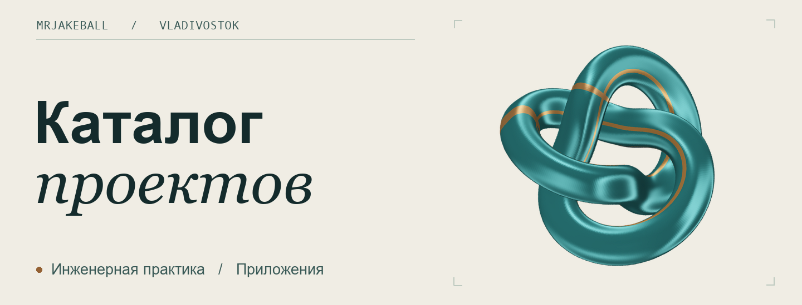

<picture>
  <source media="(prefers-color-scheme: dark)" srcset="assets/ru-dark.svg">
  
</picture>

**Приложения, тренажёры и инженерная практика.**

В витринах приватных проектов собраны экраны и технические решения. Для самостоятельного запуска доступны коллекции Postman из раздела практики.

## Инженерная практика

**[AppSec Labs](https://github.com/mrjakeball/appsec-labs)** — контроль доступа, статический анализ Python и функциональные проверки REST API.

**[Postman QA](https://github.com/mrjakeball/qa-learning-portfolio)** — коллекция JSONPlaceholder с тремя запросами GET и POST, которую можно импортировать и запустить.

## Учебные среды

### Кодограф ВВГУ

Учебная среда для Python. Студент читает задание, редактирует код и видит результат запуска в той же вкладке.

Next.js · Monaco Editor · Pyodide · Web Worker

[Открыть витрину ↗](https://github.com/mrjakeball/kodograf-vvgu-showcase)

### Linux & DevOps Trainer

Тренажёр для изучения Linux и основ DevOps. Тему о файловой системе можно прочитать, разобрать команды и перейти к лабораторной или тесту.

Python · Streamlit

[Открыть витрину ↗](https://github.com/mrjakeball/linux-devops-trainer-showcase)

## Приложения и сервисы

### TEMPO PULSE

Дневник тренировок и питания. На экране «Сегодня» собраны показатели дня, а перед тренировкой можно выбрать, где заниматься.

React 19 · TypeScript · Dexie · WebAuthn

[Открыть витрину ↗](https://github.com/mrjakeball/tempo-pulse-showcase)　·　[Открыть приложение ↗](https://tempo-fitness-pwa.pages.dev/)

### X-TREME Shop Bot

Бот оформляет заявку на покупку с Poizon или Taobao. Покупатель передаёт ссылки и параметры товаров, видит предварительный расчёт и подтверждает состав заказа перед передачей оператору.

Python 3.11 · aiogram 3 · SQLite · Pillow

[Открыть витрину ↗](https://github.com/mrjakeball/xtreme-shop-bot-showcase)　·　[Открыть бота ↗](https://t.me/XtremeShopBot)

### Pashtel

Интернет-витрина пекарни. Покупатель выбирает выпечку, меняет количество в корзине и проходит пять шагов оформления.

Next.js · TypeScript

[Открыть витрину ↗](https://github.com/mrjakeball/pashtel-showcase)

## Интерактивные проекты

### World Cup 2026 Predictor

Конструктор футбольного прогноза. Результаты групп определяют участников плей-офф, а итоговый прогноз можно сохранить, экспортировать или передать через share-code.

React · TypeScript · Vite · Zustand · Vitest

[Открыть витрину ↗](https://github.com/mrjakeball/world-cup-2026-predictor-showcase)　·　[Открыть прогноз ↗](https://courageous-elf-34b597.netlify.app/)

### NOCTRA / LUCID-1

Восемь сцен раскрывают устройство вымышленного объекта. Прокрутка ведёт от силуэта к послойному разбору конструкции и техническому досье.

React · Three.js · React Three Fiber · GSAP · Web Audio

[Открыть витрину ↗](https://github.com/mrjakeball/noctra-lucid-1-showcase)

[Telegram · @a1e5hka](https://t.me/a1e5hka)　·　[kuzmin_aleksey2004@mail.ru](mailto:kuzmin_aleksey2004@mail.ru)　·　[GitHub](https://github.com/mrjakeball)
