<picture>
  <source media="(prefers-color-scheme: dark)" srcset="assets/inlay-ru-dark.svg">
  
</picture>

<a href="README.md"><picture><source media="(max-width: 600px)" srcset="https://raw.githubusercontent.com/mrjakeball/mrjakeball/main/assets/navigation/ru-on-compact.svg?v=2"></picture></a>
<a href="README_EN.md"><picture><source media="(max-width: 600px)" srcset="https://raw.githubusercontent.com/mrjakeball/mrjakeball/main/assets/navigation/en-off-compact.svg?v=2"></picture></a>
<a href="https://github.com/mrjakeball"><picture><source media="(max-width: 600px)" srcset="https://raw.githubusercontent.com/mrjakeball/mrjakeball/main/assets/navigation/profile-ru-compact.svg?v=2"></picture></a>

**Приложения, тренажёры и инженерная практика.**

В витринах приватных проектов собраны экраны и технические решения. Для самостоятельного запуска доступны коллекции Postman из раздела практики.

## Инженерная практика

| Репозиторий | Материалы |
| --- | --- |
|  | Контроль доступа, статический анализ Python и функциональные проверки REST API. |
|  | Коллекция JSONPlaceholder с тремя запросами GET и POST, которую можно импортировать и запустить. |

## Учебные среды

### Кодограф ВВГУ

Учебная среда для Python. Студент читает задание, редактирует код и видит результат запуска в той же вкладке.

Next.js · Monaco Editor · Pyodide · Web Worker

### Linux & DevOps Trainer

Тренажёр для изучения Linux и основ DevOps. Тему о файловой системе можно прочитать, разобрать команды и перейти к лабораторной или тесту.

Python · Streamlit

## Приложения и сервисы

### TEMPO PULSE

Дневник тренировок и питания. На экране «Сегодня» собраны показатели дня, а перед тренировкой можно выбрать, где заниматься.

React 19 · TypeScript · Dexie · WebAuthn

 

### X-TREME Shop Bot

Бот оформляет заявку на покупку с Poizon или Taobao. Покупатель передаёт ссылки и параметры товаров, видит предварительный расчёт и подтверждает состав заказа перед передачей оператору.

Python 3.11 · aiogram 3 · SQLite · Pillow

 

### Pashtel

Интернет-витрина пекарни. Покупатель выбирает выпечку, меняет количество в корзине и проходит пять шагов оформления.

Next.js · TypeScript

## Интерактивные проекты

### World Cup 2026 Predictor

Конструктор футбольного прогноза. Результаты групп определяют участников плей-офф, а итоговый прогноз можно сохранить, экспортировать или передать через share-code.

React · TypeScript · Vite · Zustand · Vitest

 

### NOCTRA / LUCID-1

Восемь сцен раскрывают устройство вымышленного объекта. Прокрутка ведёт от силуэта к послойному разбору конструкции и техническому досье.

React · Three.js · React Three Fiber · GSAP · Web Audio

