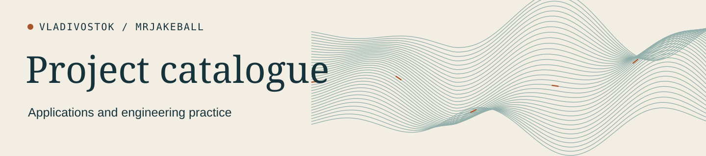

<picture>
  <source media="(prefers-color-scheme: dark)" srcset="assets/en-dark.svg">
  
</picture>

**Applications, training tools and engineering practice.**

The private project showcases pair real screens with implementation notes. The practice section includes Postman collections you can run yourself.

## Engineering practice

**[AppSec Labs](https://github.com/mrjakeball/appsec-labs/blob/main/README_EN.md)** — access control, Python static analysis and functional REST API checks.

**[Postman QA](https://github.com/mrjakeball/qa-learning-portfolio/blob/main/README_EN.md)** — an importable JSONPlaceholder collection with three GET and POST requests.

## Learning environments

### [Kodograf VVGU](https://github.com/mrjakeball/kodograf-vvgu-showcase/blob/main/README_EN.md)

A browser workspace for learning Python. The student reads a task, edits code and sees its output in the same tab.

Next.js · Monaco Editor · Pyodide · Web Worker

### [Linux & DevOps Trainer](https://github.com/mrjakeball/linux-devops-trainer-showcase/blob/main/README_EN.md)

A trainer for Linux and DevOps fundamentals. A learner can read a filesystem lesson, explore its commands and move on to a lab or quiz.

Python · Streamlit

## Applications and services

### [TEMPO PULSE](https://github.com/mrjakeball/tempo-pulse-showcase/blob/main/README_EN.md)

A training and nutrition diary. The Today screen brings daily entries together, and the workout flow starts by asking where you plan to exercise.

React 19 · TypeScript · Dexie · WebAuthn　·　[Open the app ↗](https://tempo-fitness-pwa.pages.dev/)

### [X-TREME Shop Bot](https://github.com/mrjakeball/xtreme-shop-bot-showcase/blob/main/README_EN.md)

A Telegram bot for Poizon and Taobao purchase requests. A customer submits product links and options, reviews an estimate and confirms the order before an operator receives it.

Python 3.11 · aiogram 3 · SQLite · Pillow　·　[Open the bot ↗](https://t.me/XtremeShopBot)

### [Pashtel](https://github.com/mrjakeball/pashtel-showcase/blob/main/README_EN.md)

A bakery storefront. Customers choose pastries, adjust quantities in the basket and move through a five-step checkout.

Next.js · TypeScript

## Interactive projects

### [World Cup 2026 Predictor](https://github.com/mrjakeball/world-cup-2026-predictor-showcase/blob/main/README_EN.md)

A football tournament predictor. Group results determine the knockout field, and a finished prediction can be saved, exported or shared as a code.

React · TypeScript · Vite · Zustand · Vitest　·　[Open the predictor ↗](https://courageous-elf-34b597.netlify.app/)

### [NOCTRA / LUCID-1](https://github.com/mrjakeball/noctra-lucid-1-showcase/blob/main/README_EN.md)

Eight scenes explore a fictional device. Scrolling moves the viewer from its silhouette to an exploded view and a technical dossier.

React · Three.js · React Three Fiber · GSAP · Web Audio

[Telegram · @a1e5hka](https://t.me/a1e5hka)　·　[kuzmin_aleksey2004@mail.ru](mailto:kuzmin_aleksey2004@mail.ru)　·　[GitHub](https://github.com/mrjakeball)
