<picture>
  <source media="(prefers-color-scheme: dark)" srcset="assets/inlay-en-dark.svg">
  
</picture>

<a href="README.md"><picture><source media="(max-width: 600px)" srcset="https://raw.githubusercontent.com/mrjakeball/mrjakeball/df4dc8d1f2816fd3ce9d8c316b6ed728b5015d71/assets/navigation/ru-off-compact.svg"></picture></a>
<a href="README_EN.md"><picture><source media="(max-width: 600px)" srcset="https://raw.githubusercontent.com/mrjakeball/mrjakeball/df4dc8d1f2816fd3ce9d8c316b6ed728b5015d71/assets/navigation/en-on-compact.svg"></picture></a>
<a href="https://github.com/mrjakeball/mrjakeball/blob/main/README_EN.md"><picture><source media="(max-width: 600px)" srcset="https://raw.githubusercontent.com/mrjakeball/mrjakeball/df4dc8d1f2816fd3ce9d8c316b6ed728b5015d71/assets/navigation/profile-en-compact.svg"></picture></a>

**Applications, training tools and engineering practice.**

The private project showcases pair real screens with implementation notes. The practice section includes Postman collections you can run yourself.

## Engineering practice

| Repository | Practice materials |
| --- | --- |
|  | Access control, Python static analysis and functional REST API checks. |
|  | An importable JSONPlaceholder collection with three GET and POST requests. |

## Learning environments

### Kodograf VVGU

A browser workspace for learning Python. The student reads a task, edits code and sees its output in the same tab.

Next.js · Monaco Editor · Pyodide · Web Worker

### Linux & DevOps Trainer

A trainer for Linux and DevOps fundamentals. A learner can read a filesystem lesson, explore its commands and move on to a lab or quiz.

Python · Streamlit

## Applications and services

### TEMPO PULSE

A training and nutrition diary. The Today screen brings daily entries together, and the workout flow starts by asking where you plan to exercise.

React 19 · TypeScript · Dexie · WebAuthn

 

### X-TREME Shop Bot

A Telegram bot for Poizon and Taobao purchase requests. A customer submits product links and options, reviews an estimate and confirms the order before an operator receives it.

Python 3.11 · aiogram 3 · SQLite · Pillow

 

### Pashtel

A bakery storefront. Customers choose pastries, adjust quantities in the basket and move through a five-step checkout.

Next.js · TypeScript

## Interactive projects

### World Cup 2026 Predictor

A football tournament predictor. Group results determine the knockout field, and a finished prediction can be saved, exported or shared as a code.

React · TypeScript · Vite · Zustand · Vitest

 

### NOCTRA / LUCID-1

Eight scenes explore a fictional device. Scrolling moves the viewer from its silhouette to an exploded view and a technical dossier.

React · Three.js · React Three Fiber · GSAP · Web Audio

